# BR|Crono Desktop — Guia rápido do operador

**[Baixar este guia em PDF](Guia-do-Usuario-BR-Crono-Desktop.pdf)**

## 1. O que é o BR|Crono Desktop?

O BR|Crono Desktop é o app para preparar e conferir as unidades BR Crono antes da prova. Ele faz, com botões e telas, o que o menu do BRCrono CLI já faz: encontrar o leitor na rede, conferir se ele é aprovado e, com ele conectado, ver o diagnóstico, acertar o horário, conferir as antenas, acompanhar as tags ao vivo, baixar os arquivos CSV e rodar o **Teste de Campo** de 4 etapas.

O app se conecta uma vez, na entrada, e mantém essa conexão enquanto você passa de uma tela para outra.

## 2. Instalação

**Requisitos:** Windows 64 bits, com tela de pelo menos 1280 pixels de largura útil. Telas menores (por exemplo, 1366×768 com escala de 125%) não são suportadas.

1. Abra a página de releases: <https://github.com/brunomariani/brcrono-desktop-releases/releases/latest>
2. Baixe o arquivo `BR-Crono-Desktop-Setup-<versão>.exe` (por exemplo, `BR-Crono-Desktop-Setup-0.2.0.exe`).
3. Execute o arquivo baixado.
4. O Windows deve mostrar um aviso azul, **O Windows protegeu o computador**. É esperado: o instalador não tem assinatura digital. Clique em **Mais informações** e depois em **Executar assim mesmo**.
5. No instalador, escolha **Apenas para mim**.
6. Mantenha a pasta de instalação sugerida e conclua a instalação.
7. Abra o app pelo atalho **BR Crono Desktop**.

O **BRCrono CLI continua funcionando**. Pode deixar os dois instalados: o CLI fica como plano B.

## 3. Entrada: escolher o leitor

Ao abrir, o app mostra a tela **Escolher leitor**. Há três caminhos.

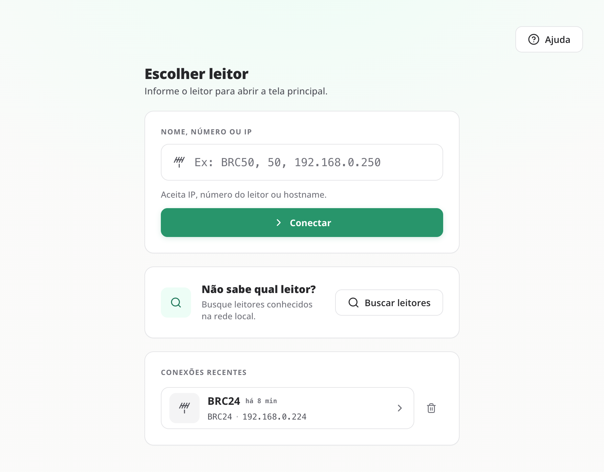

### 3.1. Conectar por nome, número ou IP

No campo **Nome, número ou IP**, informe uma das opções e clique em **Conectar**:

- **Número do leitor** — ex.: `50`
- **Nome** — ex.: `BRC50`
- **Endereço IP** — ex.: `192.168.0.250`

### 3.2. Buscar na rede

Se não souber qual leitor, use o cartão **Não sabe qual leitor?** e clique em **Buscar leitores**.

- A tela **Buscando leitores** mostra o progresso, e os leitores aparecem em **Encontrados até agora** à medida que são localizados. Você pode escolher um antes de a busca terminar.
- **Cancelar busca** volta à entrada.
- Ao final, **Leitores encontrados** lista o resultado. Clique em um para conectar, ou use **Nova busca** ou **Voltar para entrada manual**.
- Se nada for encontrado, o app mostra **Nenhum leitor conhecido encontrado na rede.** e, logo abaixo, a causa mais provável.

### 3.3. Conexões recentes

Em **Conexões recentes** ficam os últimos leitores que você abriu neste computador (até 4). Escolha um para conectar de novo. A identidade do leitor é conferida outra vez, como em qualquer conexão.

### 3.4. A conexão

Durante **Conectando**, o app percorre **Conectar** → **Número de série** → **Lista de aprovados** → **Tela principal**. **Cancelar** interrompe.

Se o nome não responder, o app procura o leitor pelo endereço MAC. Se conseguir, mostra **Conectado por IP.** e o aviso **Conexão por hostname falhou. Conectado usando IP {IP}.** A identidade é verificada normalmente.

Com tudo certo, aparece **Tudo pronto.** com o nome, o IP e o número de série do leitor. Clique em **Abrir tela principal**, ou em **Escolher outro**.

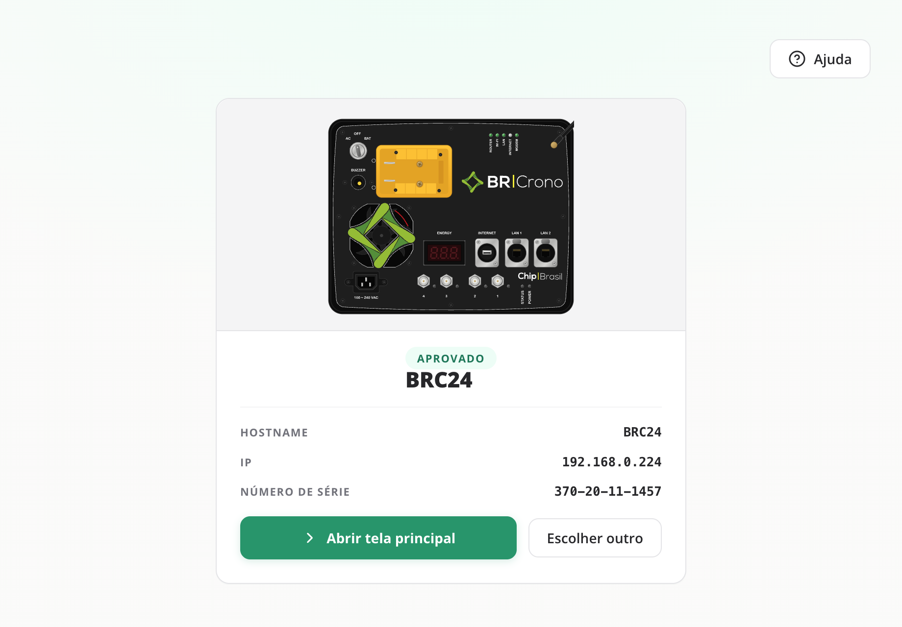

### 3.5. Ajuda na entrada

O botão **Ajuda**, no alto da tela de entrada (ou a tecla `F1`), abre os **Problemas comuns**, o botão **Registro de erros** e o botão **Verificar atualizações**, sem precisar conectar.

## 4. Acesso por leitor aprovado

Só abrem a tela principal os leitores da lista de aprovados, conferida pelo número de série.

- **Leitor aprovado** — aparece **Tudo pronto.** e a tela principal pode ser aberta.
- **Leitor não aprovado** — o app mostra o endereço e o **Número de série detectado**. Esse leitor não abre. Escolha outro com **Escolher outro leitor** ou fale com o administrador pelo canal de suporte.
- **Não foi possível verificar o leitor** — o leitor não respondeu ou o número de série não pôde ser lido. Confira a rede e use **Tentar novamente** ou **Escolher outro leitor**.

## 5. A tela principal

A barra lateral tem três grupos:

- **Operação:** **Resumo**, **Teste de Campo**
- **Operações pontuais:** **Hora**, **Antenas**, **Tags**, **Arquivos**
- **Sessão:** **Ajuda**, **Trocar leitor**, **Desconectar**

No rodapé da barra lateral aparecem as versões (**App** e **Host**).

**Atalhos de teclado:** `Ctrl+1` a `Ctrl+5` abrem **Resumo**, **Hora**, **Antenas**, **Tags** e **Arquivos**; `Ctrl+T` inicia o **Teste de Campo**; `Ctrl+R` atualiza o diagnóstico; `Ctrl+L` troca o leitor; `F1` abre a **Ajuda**.

### 5.1. Resumo (diagnóstico)

O **Resumo do leitor** mostra o **Estado geral** (**Operacional**, **Em atenção** ou **Em alerta**) e os cartões **Identidade**, **Rede**, **Plataforma**, **Leitor e antenas**, **Arquivos** e **Horário**.

- **Atualizar diagnóstico** lê tudo de novo. Se uma seção falhar, as outras continuam aparecendo, e a seção com falha tem **Tentar novamente**.
- Os cartões levam às telas de detalhe: **Sincronizar horário**, **Ver antenas**, **Transferir arquivos**.
- O cartão **Teste de Campo** traz o botão **Iniciar teste**.

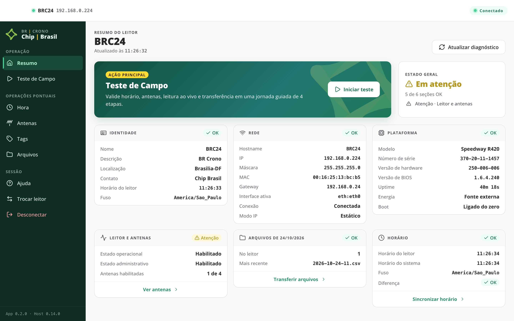

### 5.2. Hora

Compara a **Hora do leitor** com a **Hora do sistema** (o relógio deste computador) e mostra a **Diferença**:

- **OK** — menos de 1 segundo
- **Atenção** — de 1 a 1,5 segundo
- **Crítico** — mais de 1,5 segundo. O app avisa **Diferença acima do limite crítico.**

Os horários aparecem como o leitor os envia, sem conversão de fuso.

Para acertar, clique em **Sincronizar com sistema**. Essa ação altera o relógio do equipamento: as leituras e os arquivos seguintes passam a usar o novo horário. O app mostra **Antes** e **Depois**. **Reler horário** lê os dois relógios de novo.

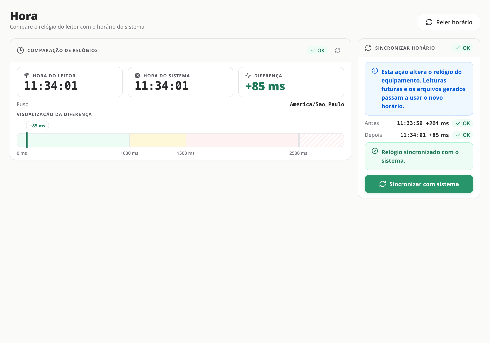

### 5.3. Antenas

**Portas do leitor** mostra cada porta (no leitor de campo, de **Porta 1** a **Porta 4**) com o **Estado**, o **Tempo energizado**, as **Tags únicas** e as **Leituras totais**. **Reler antenas** lê de novo.

Uma porta **desabilitada** é uma porta sem antena em uso ou com o cabo solto: as duas situações aparecem iguais. Se a porta deveria estar em uso, confira o cabo e o conector. **As leituras seguem pelas portas habilitadas.**

Na captura abaixo, o leitor tem antena só na porta 1; as portas 2, 3 e 4 aparecem desabilitadas.

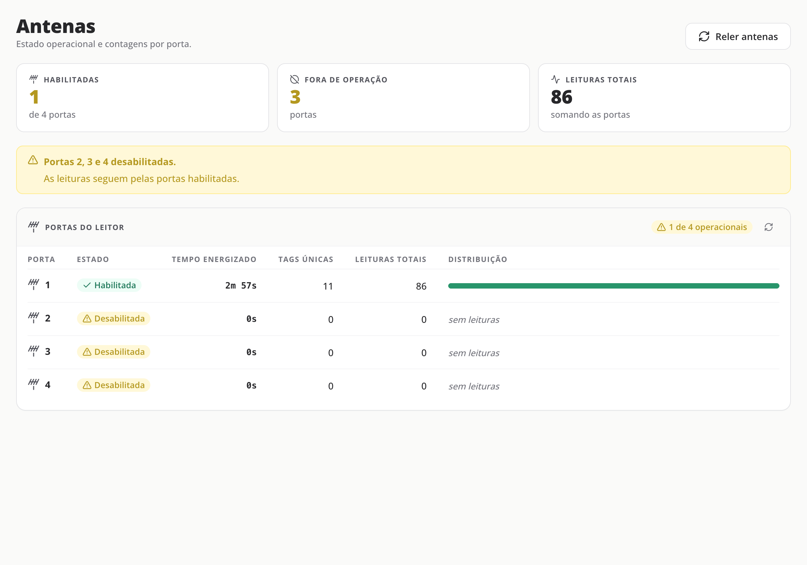

### 5.4. Tags (leitura ao vivo)

Clique em **Iniciar leitura ao vivo** para ver as passagens em tempo real, com **Leituras**, **Tags únicas**, **Duração** e o cartão **Leituras por antena**. **Interromper leitura** encerra, e **Nova leitura** começa outra.

Se você sair da tela com a leitura em andamento, o app pergunta antes: **Parar a leitura ao vivo?**

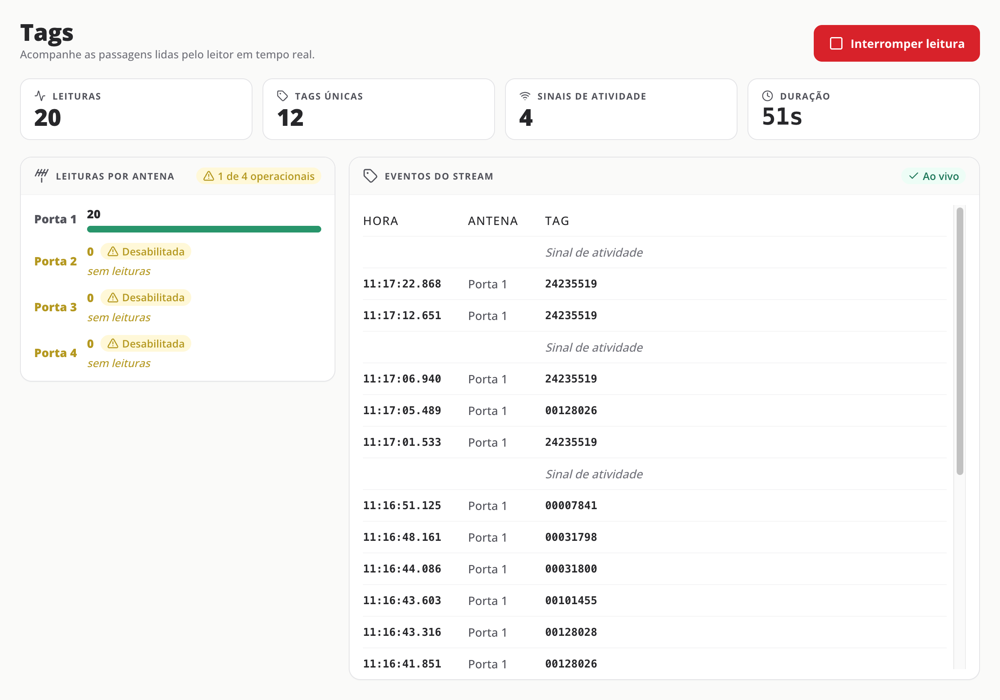

### 5.5. Arquivos (transferência dos CSV)

1. Em **Dia**, escolha a data. **Hoje** aparece primeiro; os demais ficam em **Outros dias**, e o mais recente leva a marca **mais recente** (é o escolhido ao abrir a tela).
2. Em **Destino**, **Salvar em** mostra onde os arquivos serão gravados: **Downloads (automático)** por padrão. **Escolher pasta…** troca a pasta, e **Usar Downloads** volta ao padrão. A escolha fica salva neste computador.
3. No cartão **Transferência**, em **Gravar arquivos**, escolha:
   - **Segundos** ou **Milissegundos** — use a precisão que o sistema de classificação do evento sabe ler. A escolha fica salva neste computador e vale para todas as unidades.
   - **Análise técnica** — só quando alguém pediu uma análise técnica (veja **6.3. Enviar arquivos para análise técnica**).
4. Clique em **Transferir**. O app mostra **Preparando transferência…**, **Transferindo arquivos CSV…** e **Finalizando transferência…**, e depois **Transferência concluída.**
5. **Pasta do leitor** mostra onde os arquivos ficaram, e **Abrir pasta** abre essa pasta.

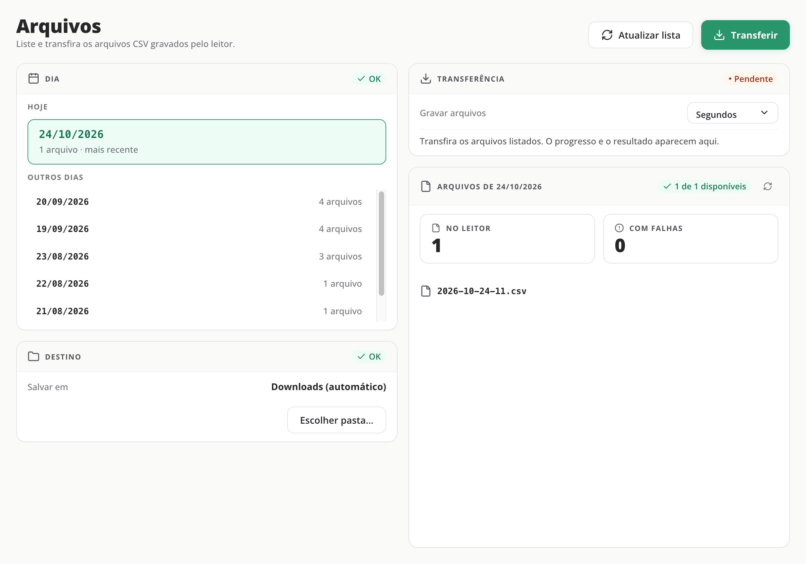

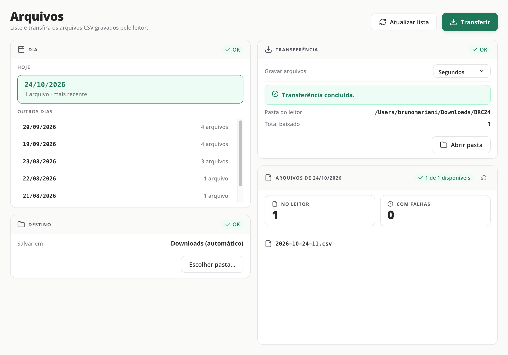

### 5.6. Teste de Campo

Uma jornada guiada de 4 etapas, para validar o leitor antes da largada:

1. **Hora** — acerta o relógio do leitor pelo horário deste computador.
2. **Antenas** — confere as portas de antena do leitor.
3. **Tags** — observa a leitura de tags ao vivo em cada antena, por até 60 segundos. Passe uma tag por cada antena; o cartão **Leituras por antena** mostra quantas portas já leram. **Encerrar leitura** termina a janela antes do fim.
4. **Arquivos** — baixa os arquivos de hoje do leitor para o destino escolhido em **Arquivos**, sempre em segundos.

Clique em **Iniciar teste**. Depois de cada etapa o teste pausa para você revisar o resultado:

- **Continuar: {próxima etapa}** segue em frente.
- **Repetir etapa** roda a mesma etapa de novo.
- **Voltar: {etapa anterior}** refaz a etapa anterior.
- **Interromper teste** encerra o teste.

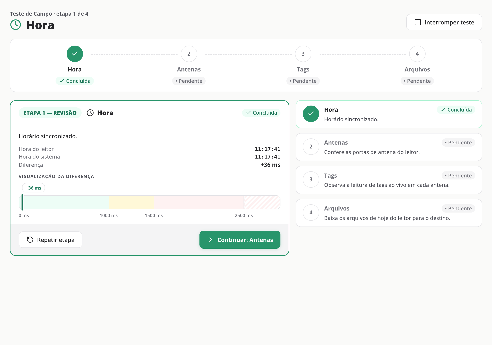

Durante a pausa você pode visitar outras telas; o **Resumo** mostra **Retomar teste** para voltar. Após a etapa 4, **Concluir teste** abre o **Resumo final**: **Sucesso completo**, **Teste concluído com alertas**, **Teste concluído com falhas** ou **Falha por ausência de antenas**. Sem nenhuma porta operacional, as etapas 3 e 4 não rodam. **Refazer teste** recomeça, e **Voltar ao Resumo** sai.

Na captura abaixo, o teste terminou com alertas porque só a porta 1 tem antena.

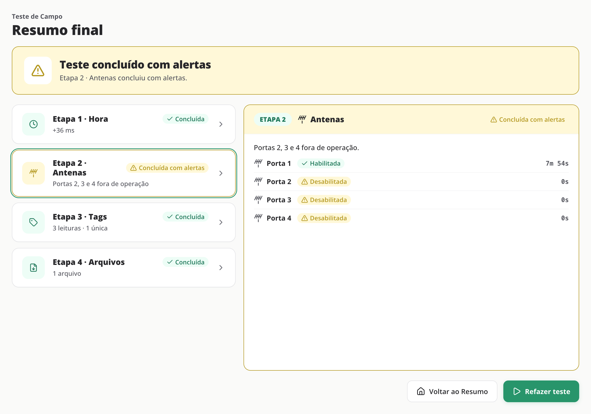

## 6. Fluxos comuns

### 6.1. Preparar uma unidade antes da prova
1. Conecte ao leitor (por nome, número, IP, busca ou recentes) e clique em **Abrir tela principal**.
2. Confira o **Estado geral** no **Resumo**.
3. Clique em **Iniciar teste** e siga as 4 etapas do **Teste de Campo**, revisando cada uma.

### 6.2. Baixar os CSV do dia
1. Abra **Arquivos**.
2. Escolha o dia em **Dia** e confira **Salvar em** e **Gravar arquivos**.
3. Clique em **Transferir** e use **Abrir pasta** para ver os arquivos.

### 6.3. Enviar arquivos para análise técnica
Quando uma unidade captou mal numa prova e alguém pediu uma análise técnica:
1. Abra **Arquivos** e escolha a data da prova em **Dia**.
2. Em **Gravar arquivos**, escolha **Análise técnica**. O app avisa: **Os arquivos não serão convertidos. A escolha vale só para a próxima transferência.**
3. Clique em **Transferir**.
4. O resultado mostra **Arquivos para análise técnica gravados em:** e o caminho da pasta `analise-tecnica`. Se algum arquivo foi baixado, aparece também **Envie essa pasta a quem pediu a análise.** **Abrir pasta** abre essa pasta.
5. Depois da transferência, **Gravar arquivos** volta sozinho para **Segundos** ou **Milissegundos**, o que estava escolhido antes.

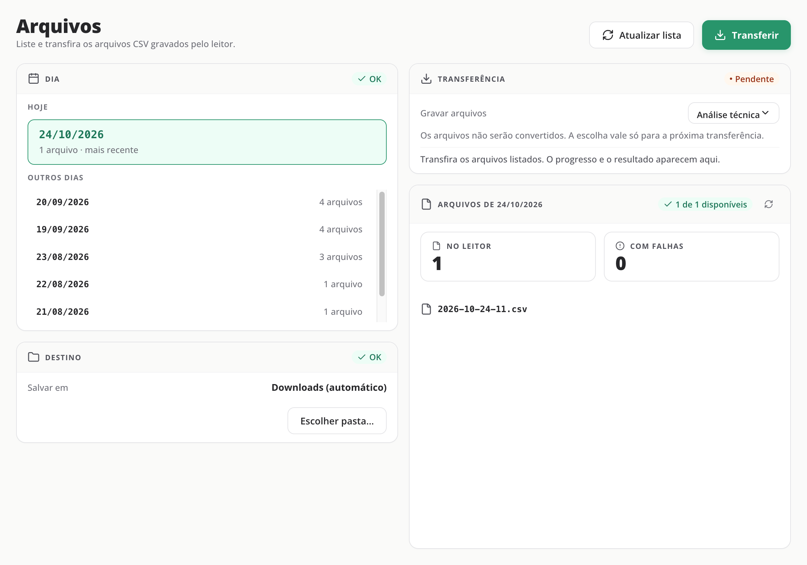

### 6.4. Trocar de leitor
1. Clique em **Trocar leitor** na barra lateral e confirme.
2. Os leitores encontrados nesta sessão continuam na lista **Encontrados nesta sessão**.
3. **Desconectar** também encerra a sessão, mas limpa essa lista.

## 7. Solução de problemas

A tela **Ajuda** (e o botão **Ajuda** na entrada) traz os **Problemas comuns** com orientação. Os casos mais frequentes:

### 7.1. O leitor não conecta
- Confira se a unidade está ligada e se o computador e o leitor estão na mesma rede.
- Confira o nome, número ou IP informado, ou use **Buscar leitores**.
- Tente de novo pela tela de entrada.

### 7.2. Wi-Fi e cabo de rede ao mesmo tempo
Se o app mostrar **Wi-Fi e cabo de rede estão na mesma rede**, desconecte o Wi-Fi e busque de novo. Com os dois na mesma rede, alguns leitores podem ficar invisíveis à busca.

### 7.3. A conexão com o leitor foi perdida
Se a unidade perder energia ou o cabo se soltar, o app mostra **A conexão com o leitor foi perdida.** Confira energia, cabo e rede e clique em **Conecte novamente**: o app verifica a identidade do leitor de novo antes de reabrir a tela principal. Um **Teste de Campo** em andamento termina e precisa ser refeito.

### 7.4. Ação demorada ou expirada
O leitor pode estar ocupado ou a rede lenta. Aguarde alguns instantes e tente de novo; a sessão continua aberta.

### 7.5. O serviço de comunicação com o leitor não está disponível
O app não consegue falar com nenhum leitor. Abra o **Registro de erros** pelo botão dessa tela e envie ao suporte (veja **9. Suporte**).

## 8. Atualizações

As atualizações chegam sozinhas: ao abrir, com internet, o app procura uma versão nova e a baixa em segundo plano. Quando ela termina de baixar, aparece **Atualização disponível** no rodapé da barra lateral e na tela **Ajuda**.

A atualização **só é instalada quando você clica em Reiniciar**. Fechar o app não instala nada: você reabre a mesma versão que testou. Prefira reiniciar fora do horário da prova.

Para procurar uma versão nova na hora, use **Verificar atualizações** na tela **Ajuda**. O app responde **O app está atualizado · versão {versão}** ou **Baixando a atualização · versão {versão}**. Sem internet, aparece **Não foi possível verificar atualizações.**

## 9. Suporte

Para dúvidas ou problemas, fale com o administrador pelo canal de suporte. Envie:

1. **Um print do rodapé da barra lateral**, onde aparece a versão (**App** e **Host**). Se não conseguir conectar, abra a **Ajuda** na entrada e clique em **Verificar atualizações**: a versão do app aparece na resposta.
2. **A pasta do registro de erros, compactada em .zip.** Na tela **Ajuda** (ou pelo botão **Ajuda** na entrada), clique em **Registro de erros**: o app abre a pasta no Explorador de Arquivos. Selecione todos os arquivos dela, clique com o botão direito e compacte em um arquivo .zip.
3. Uma frase sobre o que você estava fazendo e o que apareceu na tela.
